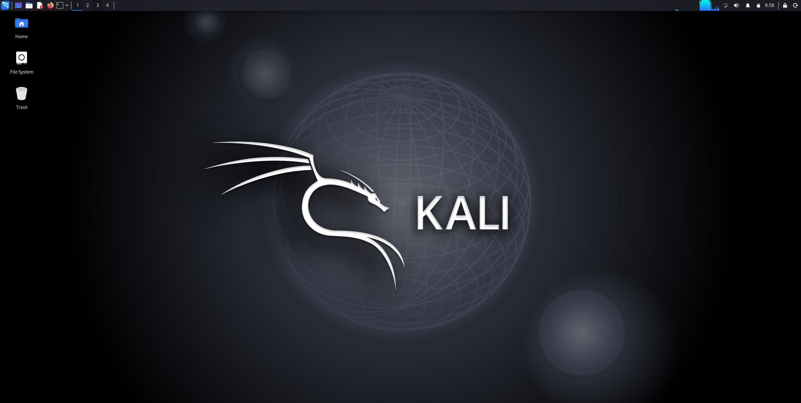
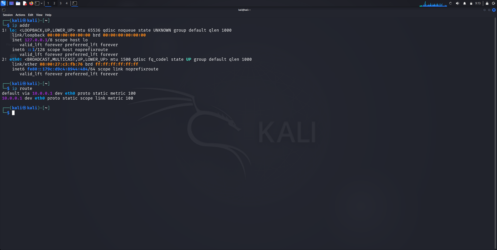

# 🔐 Cybersecurity Lab Setup | Kali Linux & VirtualBox

<p align="center">
  
  
  
  
</p>

## 📌 Project Overview

This project documents the installation and configuration of a personal cybersecurity laboratory using **Kali Linux 2026.3** and **Oracle VirtualBox** on a Windows 11 host machine.

The objective is to establish a controlled virtual environment for learning Linux administration, networking, and practical cybersecurity techniques.

This laboratory provides a foundation for hands-on cybersecurity experiments, security testing, and further exploration of penetration testing methodologies.

## 🎯 Project Objectives

- Install and configure Oracle VirtualBox.
- Deploy Kali Linux as a virtual machine.
- Understand virtualization and virtual machine management.
- Configure virtual networking using NAT Network.
- Test internet connectivity within the virtual machine.
- Develop practical Linux administration skills.
- Establish a foundation for future cybersecurity exercises.

## 🛠️ Tools & Technologies

| Tool / Technology | Purpose |
|---|---|
| Windows 11 | Host Operating System |
| Oracle VirtualBox | Virtualization Platform |
| Kali Linux 2026.3 | Guest Operating System |
| NAT Network | Virtual Network Configuration |
| Linux Terminal | Command-Line Operations |

## 🏗️ Lab Architecture

The laboratory runs on a Windows 11 host machine using Oracle VirtualBox to create and manage a Kali Linux virtual machine.

```text
          HOST MACHINE
           Windows 11
               |
               |
        Oracle VirtualBox
               |
               |
          NAT Network
               |
               |
          Kali Linux VM
               |
               |
      Cybersecurity Lab
```

## ⚙️ Virtual Machine Configuration

The following specifications were used when configuring the Kali Linux virtual machine.

| Component | Configuration |
|---|---|
| Host Operating System | Windows 11 |
| Guest Operating System | Kali Linux 2026.3 |
| OS Type | Debian (64-bit) |
| Base Memory (RAM) | 2048 MB (2 GB) |
| Processors | 2 CPU Cores |
| Video Memory | 128 MB |
| Graphics Controller | VMSVGA |
| Virtual Disk | 80.09 GB |
| Network Adapter | NAT Network |

## 🚀 Implementation Steps

### 1. Install Oracle VirtualBox

Downloaded and installed Oracle VirtualBox on the Windows 11 host machine to create a virtualized environment for running Kali Linux.

### 2. Install Kali Linux

Downloaded the Kali Linux 2026.3 VirtualBox image and imported it into Oracle VirtualBox.

### 3. Configure the Virtual Machine

Configured the virtual machine resources, including RAM, CPU cores, video memory, and virtual disk storage.

### 4. Configure Network Settings

Configured the virtual machine's network adapter to use **NAT Network**, allowing the virtual machine to access external networks through the host machine's network connection.

### 5. Boot Kali Linux

Started the Kali Linux virtual machine and verified that the operating system booted successfully.

### 6. Test Internet Connectivity

Used basic Linux networking commands to inspect network interfaces, routing information, and test internet connectivity.

Commands used:

```bash
ip addr
```

```bash
ip route
```

```bash
ping -c 4 8.8.8.8
```

### 7. Check for System Updates

Used the APT package manager to check for available package updates.

```bash
sudo apt update
```
## 📸 Project Screenshots

### 1. Oracle VirtualBox Configuration


### 2. Kali Linux Desktop


### 3. Kali Linux Terminal


## 💻 Practical Skills Demonstrated

Through this project, I gained practical experience in:

- Virtualization using Oracle VirtualBox.
- Kali Linux installation and configuration.
- Linux command-line operations.
- Basic networking and IP addressing.
- Virtual network configuration.
- Network connectivity testing.
- Basic Linux system administration.
- Setting up a controlled cybersecurity environment.

## 🔮 Future Improvements

This laboratory will serve as the foundation for more advanced cybersecurity projects.

Planned improvements include:

- Integrating Metasploitable 2 as a vulnerable target machine.
- Deploying OWASP Juice Shop for web application security testing.
- Performing network reconnaissance using Nmap.
- Conducting vulnerability assessments.
- Analyzing network traffic using Wireshark.
- Practicing penetration testing in isolated environments.
- Documenting hands-on cybersecurity exercises.

## ⚠️ Disclaimer

This laboratory was created strictly for educational purposes and authorized security testing.

All cybersecurity experiments and testing activities will be conducted only on systems that I own or have explicit permission to assess.

Unauthorized access, malicious activities, and illegal use of cybersecurity tools are not encouraged.

## 📚 References & Resources

- [Kali Linux Official Website](https://www.kali.org/)
- [Kali Linux Documentation](https://www.kali.org/docs/)
- [Oracle VirtualBox](https://www.virtualbox.org/)
- [VirtualBox Documentation](https://www.virtualbox.org/wiki/Documentation)

## 👨‍💻 Author

**Saeed Muhammad Lawal Mustapha**

Cybersecurity Student | Aspiring Cybersecurity Engineer

- GitHub: [@saeeiyd](https://github.com/saeeiyd)
- LinkedIn: [Saeed Muhammad Lawal Mustapha](https://www.linkedin.com/in/saeed-muhammad-mustapha-lawal-03a0912b4/)

---

<p align="center">
  <b>Learning by Building. Securing by Understanding. 🔐</b>
</p>
